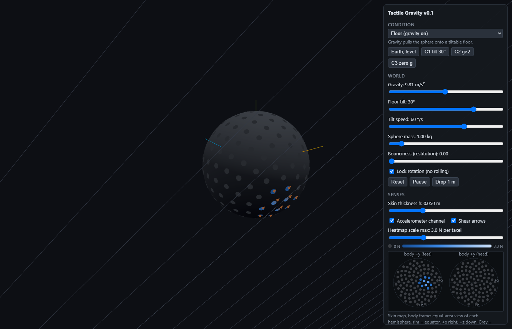
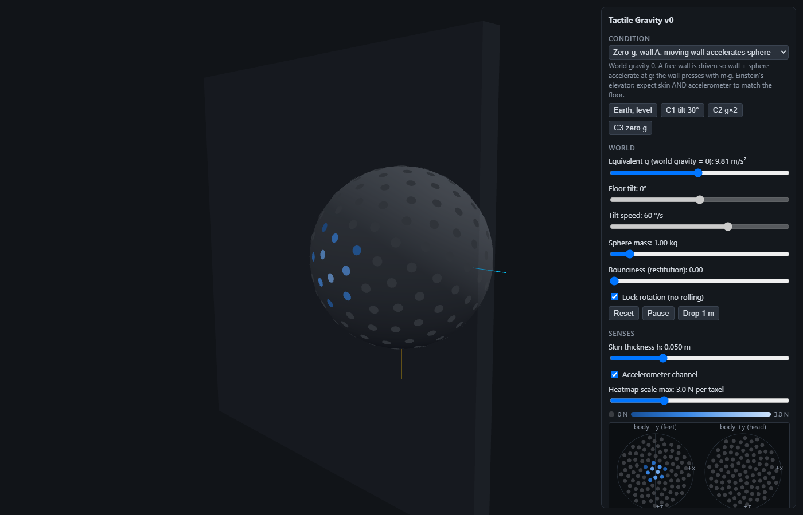
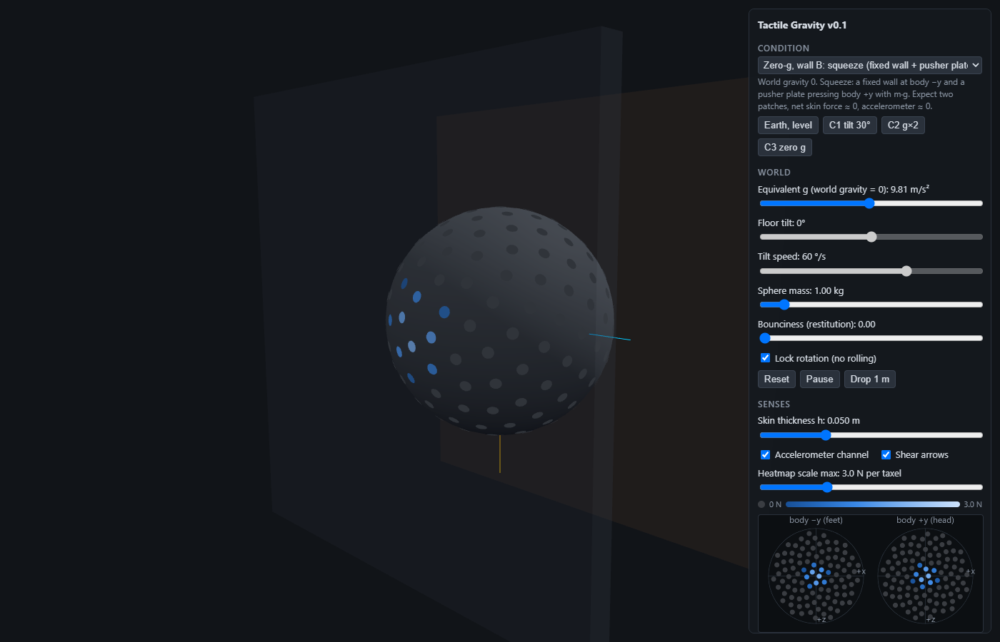
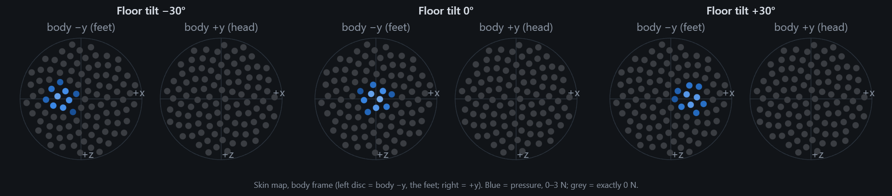
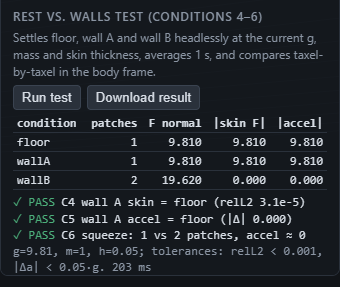

# Tactile Gravity v0.1: Results

Oct 8, 2026 · Keno Leon

This record covers v0 (Oct 7) and the v0.1 corrections (Oct 8). Where v0.1 changes a v0 claim, the corrected version is the one stated, and the change is noted under Findings.

## Summary

All checks pass for conditions 1–7. A pressure-only skin (v0) finds the **floor normal**, not "down": on a 30° tilt it is 30° off true gravity. Adding shear (v0.1) gives the full contact-force vector, which points exactly opposite gravity whenever the body is at rest.

The research question is whether an AI can infer gravity (direction, magnitude, stability) from a tactile skin. This is the sensing testbed only: a 1 kg sphere with 200 taxels on a tiltable floor, plus two zero-g wall setups. Arms, an AI control loop, RL and other senses were deliberately left out.

- **Direction:** normal pressure alone finds the floor normal, with an error ≈ the tilt angle versus true down. The skin force vector (normal + shear) reads 0.0000° from true down on −40° to 40° tilts, but that is an **instrument check**, not evidence: shear is derived from the same dynamics as the accelerometer, and with the body frame equal to the world frame (v0.1) a constant guess of body −y also scored 0.0000°. v0.2 randomises the body orientation and adds a leak audit (see the v0.2 evaluation).
- **Magnitude:** the skin senses m·g, never g. 2 kg at 9.81 m/s² and 4 kg at 4.905 m/s² feel identical.
- **Equivalence:** a wall accelerating the sphere at g in zero gravity is indistinguishable from resting on the floor, by skin AND accelerometer. No local sense can tell gravity from acceleration.
- **Squeeze vs. rest:** being squeezed between two plates (zero g) is told apart from resting by the skin alone: two patches instead of one, and zero net force. The accelerometer reads 0.
- **Corrected in v0.1:** v0's wall B used a push the skin couldn't feel and the accelerometer ignored. It was physically inconsistent and has been replaced (Findings 1).
- **Simulation artifacts found and removed:** a tilting floor that launched the sphere, solver penetration leaking into the skin, and Rapier's JS API reporting zero friction impulses.



*The app on a floor tilted 30°. Pressed taxels show blue; orange arrows show shear (friction) pointing up the slope.*

## Setup

The body is a rigid sphere (radius 0.5 m, default mass 1 kg) simulated in Rapier 0.21.0 at 60 Hz. Its rotation stays locked, so the patch moves because the floor tilts, not because the body rolls.

| Mode | World gravity | What presses the sphere | Purpose |
| --- | --- | --- | --- |
| Floor | g along −y | Floor reaction: normal m·g·cosθ plus friction m·g·sinθ. A 12 × 12 m floor with 0.6 m rim walls that tilt with it | Conditions 1–3, 7 |
| Wall A | 0 | Free 1 kg wall driven with (M_wall + m)·g, so wall and sphere accelerate together at g | Einstein's elevator (4, 5) |
| Wall B (v0.1) | 0 | Fixed wall at body −y plus a 1 kg pusher plate driven into body +y with m·g: a squeeze | Squeeze vs. rest (6) |

In both wall modes the sphere is rotated so body −y faces the fixed wall. The wall then touches the same body point as the floor, and comparisons are taxel-for-taxel in the body frame.



*Wall A in zero gravity. The wall touches body −y, so the skin map (bottom right) shows the same patch as a level floor.*



*Wall B (v0.1) in zero gravity. The skin map shows two patches, at body −y and +y; the panel reports net skin force 0 and accelerometer 0.*

| Parameter | Range | Default |
| --- | --- | --- |
| Gravity / equivalent g (m/s²) | 0–20 | 9.81 |
| Floor tilt (°) | −60 to 60 | 0 |
| Tilt speed (°/s) | 1–90 | 20 |
| Sphere mass (kg) | 0.1–10 | 1 |
| Restitution | 0–1 | 0 |
| Skin thickness h (m) | 0.01–0.15 | 0.05 |
| Friction (floor, walls and sphere) | fixed | 1.0 (friction angle 45°) |

## Skin model and sensor channels

The physics engine supplies how much force acts on the sphere, and geometry supplies where on the skin it lands. Taxels sum exactly to the engine's force, for both pressure and shear.

1. **Layout:** 200 taxels in a Fibonacci-sphere layout, stored in body-local coordinates p_i.
2. **Normal force, per touching surface:** Σ contactImpulse / timestep from Rapier's contact manifold (`world.contactPair`). At rest this matches m·g·cosθ to 4 decimal places.
3. **Tangential force (v0.1), per touching surface:** taken from the sphere's dynamics, because Rapier's JS tangent impulses read 0 (Findings 3). The net contact force is m·Δv/Δt − m·g_world minus any applied forces. Subtracting the manifold normal forces leaves the tangential force. With several non-parallel contacts (floor + rim) it uses the minimum-norm split: the smallest forces, each in its own contact plane, that sum exactly to the residual. With parallel contacts (the squeeze) it splits in proportion to normal force. Anything left over is logged as `unassignedContactForceWorld` in `truth`.
4. **Distribution:** each taxel's height above the ideal tangent plane of the undeformed sphere, weighted linearly within the skin thickness h. Shear uses the same weights as pressure.
5. **Patches (v0.1):** pressed taxels (> 0.01 N) are grouped by single linkage. Taxels within 30° of each other join a patch, so patches more than 30° apart count as separate.
6. **Summary:** total normal force, centre of pressure, contact area, peak taxel; v0.1 adds patch count, per-patch force, direction, shear and force vector, and the skin force vector (normal + shear, body frame) with its magnitude and direction.

```math
w_i = \operatorname{clamp}\!\left(1 - \frac{\mathbf{n}_{\mathrm{body}} \cdot \mathbf{p}_i + r}{h},\, 0,\, 1\right), \qquad P_i = F \, \frac{w_i}{\sum_j w_j}, \qquad \mathbf{s}_i = \mathbf{T}_{\mathrm{body}} \, \frac{w_i}{\sum_j w_j}
```

With the default h = 0.05 m, about 10 taxels are pressed per contact.

| Channel | Content | Default |
| --- | --- | --- |
| `taxels` | 200 normal pressures (N), unchanged from v0 | on |
| `shear` (v0.1) | 200 × [x, y, z] tangential force (N, body frame) | on |
| `summary` | v0 fields, plus patchCount, patches, skinForce, skinForceMagnitude, skinForceDir | on |
| `accelerometer` | Body-frame proper acceleration Rᵀ(Δv/Δt − g_world) | off (null) |
| `truth` | Engine normal and tangential forces, net contact force, gravity in the body frame, penetration, pose, accelerometer always. Not sensory | logged |

v0 logs stay readable: v0.1 only adds fields.

## Results

Every check passes. Each value is a 1 s average after a 5 s settle, from `npm run verify`, which re-runs headlessly and exits non-zero on any failure.

| Condition | Question | Measured | Pass criterion |
| --- | --- | --- | --- |
| 1. Floor tilt −40° to 40° | Does the patch move across the body? | CoP follows the floor normal within 1.3°; normal force = m·g·cosθ to 4 dp | CoP error < 2° |
| 2. g = 2, 4.905, 19.62 | Same patch, scaled pressure? | CoP shift 0.000°; taxels = (g/9.81) × reference, relL2 ≤ 1.5e-8 | relL2 < 1e-3 |
| 2b. (2 kg, 9.81) vs (4 kg, 4.905) | Can the skin tell mass from gravity? | Skin identical (relL2 0). Accelerometer 9.81 vs 4.905 m/s² | Skin identical |
| 3. g = 0 | All taxels silent? | Every taxel exactly 0 N | All exactly 0 |
| 4. Floor vs wall A | Tactile match? | relL2 3.1e-5, ΔCoP 0.000°, shear 0 in both | relL2 < 1e-3 |
| 5. Floor vs wall A, accelerometer on | Do readings match? | Yes: both 9.810 m/s² along body +y, Δ 0.0001 | \|Δa\| < 0.05·g |
| 6. Floor vs wall B (squeeze) | Can the skin alone tell squeeze from rest? | Patches 1 vs 2 (9.81 N at body −y and +y); net skin force 9.81 vs 0.000 N; wall B accelerometer 0.000 | Patch counts 1 and 2, accelerometer ≈ 0 |
| 7. Floor tilt −40° to 40°, skin force bookkeeping (instrument check) | Does the full skin force vector equal −m·g at rest? | Error 0.0000°, \|F\| = 9.8100 N; true by construction (shear is dynamics-derived). The informative part is the contrast: normal-only CoP error ≈ tilt | Vector error < 2°, \|F\| = m·g |

Conditions 4–6 were also run at g = 3.71 m/s² with m = 2.5 kg, with the same verdicts.

Condition 5's pass criterion changed in v0.1. v0 also required "wall B accelerometer differs", which relied on the inconsistent wall B and was retired with it.

### Condition 7 detail (instrument check)

Corrected in v0.2 (planner review 004): this table checks bookkeeping, not the hypothesis. With rotation locked at the spawn orientation (v0.1), the body frame equalled the world frame, so "true down" was always body −y and a constant guess would also have scored 0.0000°. The pressure-only column is the informative one.

| Floor tilt | Normal-only CoP error vs true down | Skin force vector error | \|skin force\| (N) |
| --- | --- | --- | --- |
| −40° | 39.31° | 0.0000° | 9.8100 |
| −30° | 30.73° | 0.0000° | 9.8100 |
| −20° | 20.73° | 0.0000° | 9.8100 |
| −10° | 9.74° | 0.0000° | 9.8100 |
| 0° | 0.46° | 0.0000° | 9.8100 |
| 10° | 10.10° | 0.0000° | 9.8100 |
| 20° | 19.69° | 0.0000° | 9.8100 |
| 30° | 30.03° | 0.0000° | 9.8100 |
| 40° | 40.19° | 0.0000° | 9.8100 |
| 50°, sliding (recorded, not judged) | 49.55° | 5.00° | 8.9177 |

**Solver check, not a skin result.** At 50° the tilt is past the friction angle (45°), so the sphere slides. (μ = 1 for both sphere and floor.) The skin vector then matches Coulomb sliding exactly: magnitude m·g·cos50°·√2 = 8.9177 N, tilted 45° from the normal, which is 5° from true down. The accelerometer reads the same 8.9177 m/s².



*Condition 1: as the floor tilts from −30° to +30°, the pressure patch moves across the body along x, following the floor normal.*



*Conditions 4–6 from the app's Run test button.*

## Findings and interpretation

### 1. v0's wall B was physically inconsistent (retracted)

v0's wall B pressed the sphere into a fixed wall with a body force at its centre, and the accelerometer read 0. No real stimulus does that. A force acting on every mass element is gravity in all but name, so a real accelerometer would read g and match the floor. A force applied through a surface would read 0, but the skin would feel it. v0's accelerometer formula only subtracted world gravity, so it treated that force as neither.

v0.1 replaces it with a real pusher plate. The skin now feels both contacts, and the accelerometer correctly reads 0. The v0 statement that "only wall B makes the accelerometer differ" is withdrawn. The equivalence result stands: the honest wall A matches the floor on every local sense.

### 2. Pressure finds the floor; the full force vector finds "down", but only at rest

v0's claim that the skin "recovers the direction of down" was wrong. Normal pressure finds the floor normal, and its error versus true gravity equals the tilt. Conditions 1–3 verify the instrument (sphere geometry guarantees them with rotation locked), not the hypothesis.

Adding shear gives the full contact force, which points opposite gravity with magnitude m·g whenever the body is static. That is Newton's law, not a separate skill of the skin. When only contacts act, the skin force vector equals m times the accelerometer reading at every step. So the skin can stand in for an accelerometer up to the body's mass, and the two together give the mass: m = |F_skin| / |a|. Off equilibrium the equality with "down" breaks: sliding at 50° moves the vector 5° and drops it to 8.92 N.

### 3. Rapier 0.21's JS API reports zero friction (worked around)

`contactTangentImpulseX/Y` exist but return exactly 0: at rest, rolling and sliding, in both collider orders. Friction is applied all the same; a 50° slide matches μ = 1 to the third decimal. The same zeros appear in 0.20.0 and 0.19.3, and NaN in 0.17.3 and 0.14.0. `ContactForceEvent` and `solverContactTangentVelocity` don't help either. Shear therefore comes from the sphere's dynamics (Skin model, step 3). This is exact bookkeeping for one contact, or several parallel ones, but cannot attribute shear between non-parallel contacts. The probe is in `scripts/probe_shear.mjs`.

### 4. Squeeze vs. rest needs the pattern, not the sum

The squeeze's net skin force is 0, the same as free fall, where the skin is silent. Only the pattern (two opposite patches of 9.81 N) shows the body is loaded. Any agent-side summary that keeps only the net force would confuse "squeezed" with "floating".

### 5. Mass and gravity stay confounded on the skin

The skin measures m·g in every variant, so 2 kg on Earth and 4 kg at half-g feel identical. The accelerometer reads g regardless of mass, so combining the two channels separates them.

### 6. Earlier simulation artifacts (fixed in v0)

- **Solver penetration leaked into the skin.** Rapier's soft contacts sink 0.06–0.55 mm, and the depth differed by setup at equal m·g. The first skin partly sensed that and failed the equivalence test (relL2 ≈ 5e-3). Measuring against the ideal undeformed surface fixed it.
- **A tilting floor launched the sphere.** A kinematic floor snapped to a new angle in one step threw the sphere at up to 55 m/s. The floor now turns at a bounded rate about the point under the sphere; lift-off is 0 mm in every tested case.

These are the kind of quirks an agent could exploit to "detect" gravity from the simulator instead of physics. Re-run `npm run verify` whenever the physics changes.

## Limitations

- **Shear source.** Shear is inferred from the sphere's dynamics, not read from the solver (Findings 3). Its total is exact; the per-contact split is a modelling choice.
- **Rim corner is statically indeterminate.** A ball wedged between floor and rim can be held by many force combinations. Corrected in v0.2: if the rim were frictionless, the admissible rim normal at 50° would be m·g·sin50° ± μ·m·g·cos50° = [1.21, 13.82] N (7.5 N is the frictionless-floor value, not a minimum); with the actual rim μ = 1 the 45° + 45° friction cones span the 90° wedge, so it can self-lock and the range has no upper bound. Measured (v0.2 probe 0b), the same wedge settles at rim normal 4.75, 7.52 or 13.82 N depending on how the ball got there; sliding in always gives 13.82 N with floor friction saturated and pointing downhill, likely a position-correction artefact. "0 N unassigned" in the corner is a property of the minimum-norm split (two non-parallel contact planes always close it), not a result. Wedged scenes are excluded from the v0.2 evaluation.
- **Shear frame.** Each taxel's normal and shear are split along the contact plane, not the taxel's own tangent plane. The 3D sum is unaffected.
- **Patch shape does not change with load.** Only pressure scales with g, so contact area carries no magnitude information.
- **Taxel quantisation.** With about 10 taxels pressed, the CoP direction sits up to 1.3° off the contact direction.
- **Static scenes.** Rotation is locked; stability (rocking, rolling) is not tested beyond the 50° slide.
- **Ideal sensors.** No noise, saturation, hysteresis or adaptation on any channel.

## State of the app

v0.1 runs locally from `C:\DEV\CAI\TactileGravity` (three.js, Rapier 0.21.0, Vite) and is in the private repo KenoLeon/TactileGravity.

```
npm install
npm run dev            # the app
npm run verify         # conditions 1–7 + 2b, headless; non-zero exit on failure
npm run check          # engine force vs m·g·cosθ
npm run probe:bounce   # launch/bounce regression + restitution drop test
node scripts/probe_shear.mjs   # what Rapier reports for friction impulses
npm run build:doc      # rebuild the image-embedded standalone copy of this doc
```

| File | Role |
| --- | --- |
| `src/sim.js` | Physics world, the three modes, contact forces (normal from manifolds, tangential from dynamics), accelerometer |
| `src/skin.js` | Taxel layout, distribution of pressure and shear, patches, summary |
| `src/sensors.js` | Per-step JSON frame: sensory channels kept separate from `truth` |
| `src/experiments.js` | Settle, average and compare conditions; the rest vs. walls test |
| `src/main.js` | Rendering, heatmap, shear arrows, skin map, panel, recording |
| `scripts/verify_conditions.mjs` | Numeric verification of all conditions |

The UI has these parts:

- **Condition picker:** floor, wall A or wall B (squeeze), plus presets for C1 (tilt 30°), C2 (g×2), C3 (zero g) and level Earth.
- **Sliders** for every parameter in the Setup table, an accelerometer toggle and a shear-arrows toggle.
- **Live heatmap** on the sphere and a **skin map** of two equal-area hemisphere discs. Hovering any taxel shows its value.
- **Live summary panel:** patches, skin force vector, and (as "truth, not sensed") true down with the CoP and skin-vector errors.
- **Run test button** for conditions 4–6, with verdicts and a JSON download.
- **Record button,** which logs every physics step, including the `shear` channel, to a downloadable JSON file.

## Next steps and new ideas

Still out of scope: arms, agent loop, RL, noise model and Hertzian patch. Candidates, roughly in order of how directly they test the research question:

- [ ] **Load-dependent contact patch** (Hertzian radius a ∝ (F·R)^(1/3)), so contact area carries magnitude information.
- [ ] **Sensor realism:** per-taxel noise, saturation, hysteresis and slow/fast adaptation, plus accelerometer noise and bias.
- [ ] **Stability and slip:** unlock rotation and test whether instability shows up early, e.g. as the shear-to-normal ratio approaching μ before the slide starts.
- [ ] **Mass from two channels (new):** a condition 2c checking that |skin force| / |accelerometer| recovers body mass across the 2b pairs.
- [ ] **Free fall vs. squeeze vs. rest (new):** add a contact-free zero-g case so condition 6 also checks that net force alone can't separate squeeze from free fall.
- [ ] **Solver-side shear (new):** re-probe each Rapier release for working tangent impulses and cross-check against the dynamics-derived shear; needed before non-parallel multi-contact scenes such as a floor + wall corner.
- [ ] **Per-taxel 3-axis frame (new):** report each taxel's force in its own normal/tangent frame, as a real tri-axial taxel would.
- [ ] **Gyroscope,** the companion to the accelerometer for a vestibular analogue.
- [ ] **The two arms** (different DoF per arm) with proprioception. Posture-dependent joint loading is a gravity cue no wall can fake.
- [ ] **Agent loop:** a fixed observation API around the frame builder, and scripted probes before any RL.
